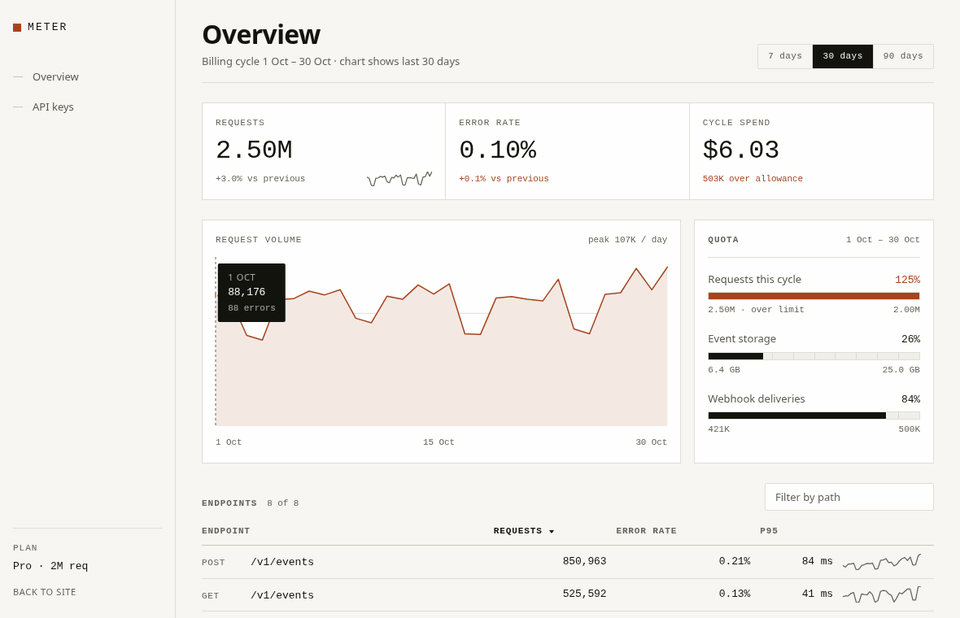
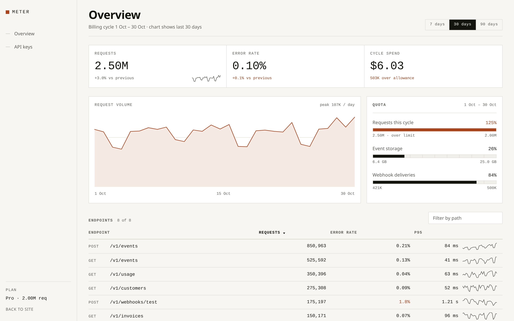
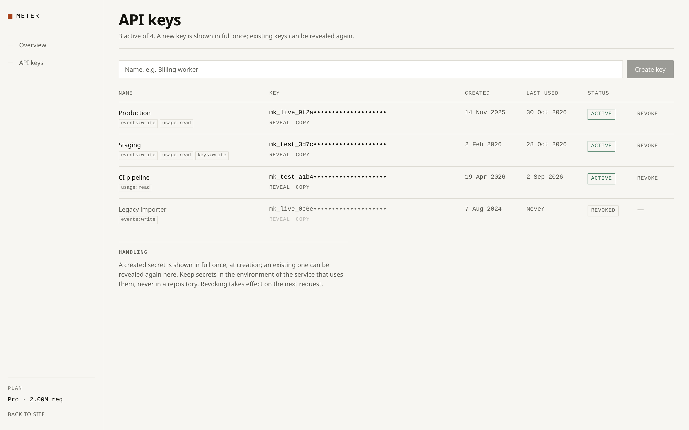
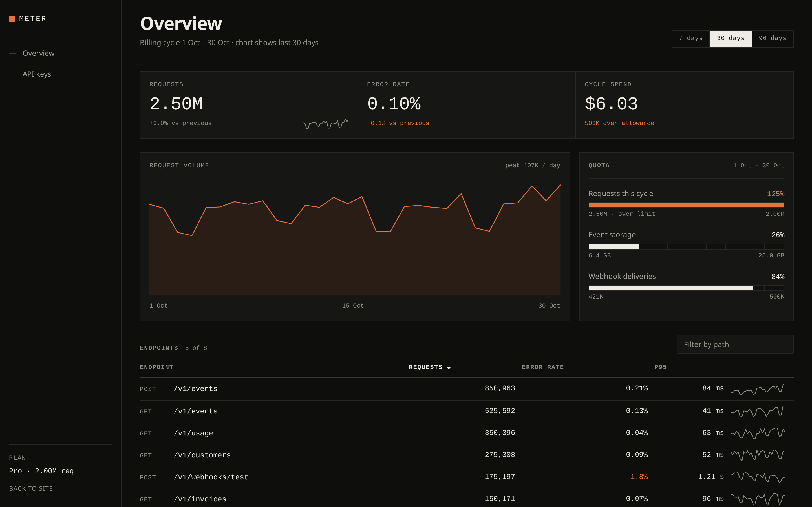
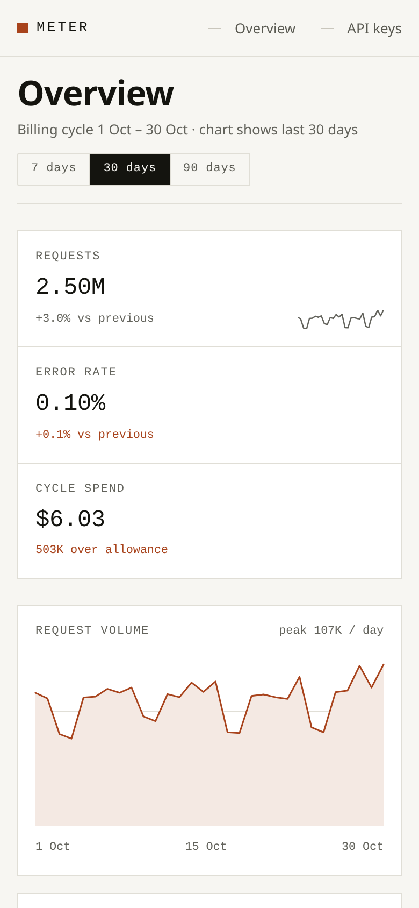

# Meter

**Usage and billing for API products.** Request volume, quota consumption,
error rate, and spend in one place, so a metered invoice never arrives as a
surprise.

[](https://github.com/vezeqs/api-meter/actions/workflows/ci.yml)
[](https://github.com/vezeqs/api-meter/actions/workflows/deploy.yml)
[](LICENSE)

**[Live preview →](https://vezeqs.github.io/api-meter/)**



## What it is

A working front end for a metered API product. It reads a request log and
answers the four questions a customer actually asks: how much have I used, how
much is left, is anything failing, and what will this cost.

The interface is built as a precision instrument rather than a wall of cards:
hairline rules, tabular figures, one accent colour, and a quota bar that turns
at ninety percent instead of after the invoice.

This repository is a **demonstration build**. Every figure is generated from a
fixed seed in [`apps/web/lib/data.ts`](apps/web/lib/data.ts); nothing is
collected from a real service.

## Screens

| Overview                        | API keys                   |
| ------------------------------- | -------------------------- |
|  |  |

| Dark theme                                         | 390 px                                                                                     |
| -------------------------------------------------- | ------------------------------------------------------------------------------------------ |
|  |  |

## The billing model

The distinction the whole product rests on: **analysis and billing are
different scopes.**

The range selector (7 / 30 / 90 days) moves the chart, the endpoint table, and
the headline volume. It never moves the quota meters or the spend, because a
billing cycle is thirty days whether or not you are looking at a week of it.

|                                 | Scope          | Example                 |
| ------------------------------- | -------------- | ----------------------- |
| Requests, error rate, endpoints | selected range | 2.50M over 30 days      |
| Quota, overage, spend           | billing cycle  | 2.50M of 2.00M included |

Spend is **overage only**. The Pro plan includes 2,000,000 requests and bills
$12 per million beyond that, so 2.50M in a cycle costs `0.50M × $12 = $6.03`.
The plan fee is separate and is not usage. Charging the whole volume at the
overage rate — which an earlier version of this code did — overstates the
invoice five-fold.

## What it does

**Request volume.** A daily series per endpoint. The chart responds to the
keyboard as well as the pointer: arrow keys walk the series, Home and End jump
to the ends, and every step is announced to assistive technology.

**Quota.** Used against the cycle allowance, with tick marks every ten percent.
The bar switches to the accent colour at ninety percent and reports an overage
once the limit is passed.

**Endpoints.** Sortable by any numeric column, filterable by path, with a
sparkline beside each row. Per-endpoint totals reconcile with the headline
figure, and a test fails if they drift more than two percent.

**API keys.** Reveal, copy, revoke with confirmation, and create. A new secret
is written in full once. Revoked keys cannot be revealed or copied.

## Verified

Everything below is enforced in CI on every push. The same suite can be pointed
at the live deployment:

```sh
PLAYWRIGHT_ORIGIN=https://vezeqs.github.io pnpm test:e2e
```

| Suite                    | What it proves                                                                                               |
| ------------------------ | ------------------------------------------------------------------------------------------------------------ |
| Unit (`node:test`)       | Number formatting, unit rollover, billing arithmetic, endpoint reconciliation, asset integrity, tool hygiene |
| End-to-end (Playwright)  | Layout, console health, SEO output, axe-core, every control                                                  |
| Tool smoke (`node:test`) | The Open Graph card renders; the capture tool resolves its imports                                           |

`pnpm test` prints the count for each suite. Per-release figures live in
[`CHANGELOG.md`](CHANGELOG.md), where a snapshot is dated and cannot silently
drift.

The end-to-end suite checks, on all three routes:

- No console errors or uncaught exceptions
- No horizontal overflow at 1440, 768, 390, and 320 px — verified by
  attempting to scroll, not by comparing widths
- One `h1` and a working skip link
- Every interactive element has an accessible name, with a guard that fails if
  a page has nothing to check
- No axe-core violations under WCAG 2.1 AA, in **light and dark** themes
- Internal links carry the deployment subpath
- `sitemap.xml` and `robots.txt` are served with correct absolute URLs

And behaviourally: sorting in both directions, filtering and its empty state,
keyboard chart navigation, tooltip on hover, key reveal, clipboard copy, revoke
confirmation, key creation, and the four billing invariants above.

## Code review

The repository has been audited three times, each pass recorded in a dated
file under `docs/` with a command that reproduces every finding before it was
fixed: [fifteen findings](docs/audit-2026-10-30.md) including two billing
defects and a false claim in this README, [six more](docs/audit-2026-10-31.md)
mostly in the verification itself, and [fourteen](docs/audit-2026-10-31-third-pass.md)
in the third pass — a preview server that dies on a malformed `Host` header,
an OG card quoting quotas the product disowns, and a `pnpm test:unit` that
secretly needed a build.

## Stack

|           |                                                |
| --------- | ---------------------------------------------- |
| Framework | Next.js 16, App Router, static export          |
| Language  | TypeScript 6, strict                           |
| UI        | Hand-written CSS Modules, no component library |
| Charts    | Inline SVG, no charting dependency             |
| Tests     | `node:test` + Playwright with axe-core         |
| Workspace | pnpm + Turborepo                               |

The web app is hand-written TypeScript and CSS Modules, with no UI framework,
no CSS framework, and no charting library. Count it yourself:

```sh
find apps/web/app apps/web/components apps/web/lib -type f \
  \( -name '*.ts' -o -name '*.tsx' -o -name '*.css' \) | xargs wc -l | tail -1
```

## Getting started

Requires Node 24 (see `.nvmrc`) and pnpm 10.34.8 (pinned in `packageManager`).

```sh
pnpm install
pnpm exec playwright install chromium   # once, for the end-to-end and tool suites
pnpm build
pnpm preview
```

Then open <http://127.0.0.1:4321/api-meter/>. `pnpm preview` serves the export
from a subpath, the same way GitHub Pages will.

For development with reloading:

```sh
pnpm dev    # http://localhost:3000/api-meter/
```

## Commands

| Command                        | What it does                                                 |
| ------------------------------ | ------------------------------------------------------------ |
| `pnpm verify`                  | Format, lint, typecheck, build, then every test              |
| `pnpm dev`                     | Run the apps in watch mode                                   |
| `pnpm build`                   | Build every package, export the site to `apps/web/out`       |
| `pnpm preview`                 | Serve the export at a GitHub Pages-like subpath              |
| `pnpm test:unit`               | Data and formatting tests, no browser                        |
| `pnpm test:e2e`                | Playwright audit against the built export                    |
| `pnpm test:tools`              | Smoke-render the card and resolve the capture tool           |
| `pnpm lint` / `pnpm typecheck` | ESLint / `tsc --noEmit` across the workspace                 |
| `pnpm capture`                 | Regenerate the screenshots and GIF in `docs/` (needs ffmpeg) |
| `pnpm og`                      | Regenerate `apps/web/public/og.png`                          |

## Deployment

`.github/workflows/deploy.yml` builds the static export and publishes it to
GitHub Pages. The base path and canonical origin are derived from the
repository at build time, so renaming the repo does not break links.

Search engine handling:

- `app/sitemap.ts` and `app/robots.ts` generate `sitemap.xml` and `robots.txt`
  at build time; `lastmod` is the build date
- The landing page is indexable, with a canonical URL, Open Graph tags, and
  `SoftwareApplication` structured data
- `/dashboard` is excluded with both `noindex` and a `robots.txt` rule

## Project structure

```
apps/
  web/        Next.js app, exported to static files
  api/        Fastify service — skeleton, not yet consumed by the web app
packages/
  shared/     Types and constants used by both
tests/
  unit/       node:test suites for data and formatting
  e2e/        Playwright audit and behaviour suites
tools/
  serve-export.mjs   Static server that mimics GitHub Pages
  capture.mjs        Screenshots and the demo GIF
  og.mjs             Open Graph card
```

## Known limitations

Stated plainly, because a demo that pretends to be more is worse than a demo.

- **The data is generated.** Fixed seed, fixed reference date, no backend.
- **There is no authentication.** The dashboard is a public static page.
- **`apps/api` is a skeleton.** It serves `/health` and is smoke-tested in CI,
  but the web app never calls it — a static export has nothing to call it
  with.
- **`robots.txt` under a project subpath is not read by crawlers.** They only
  fetch it from the host root. The `noindex` meta tag on the dashboard is the
  rule that actually takes effect.

## License

MIT. See [LICENSE](LICENSE).
